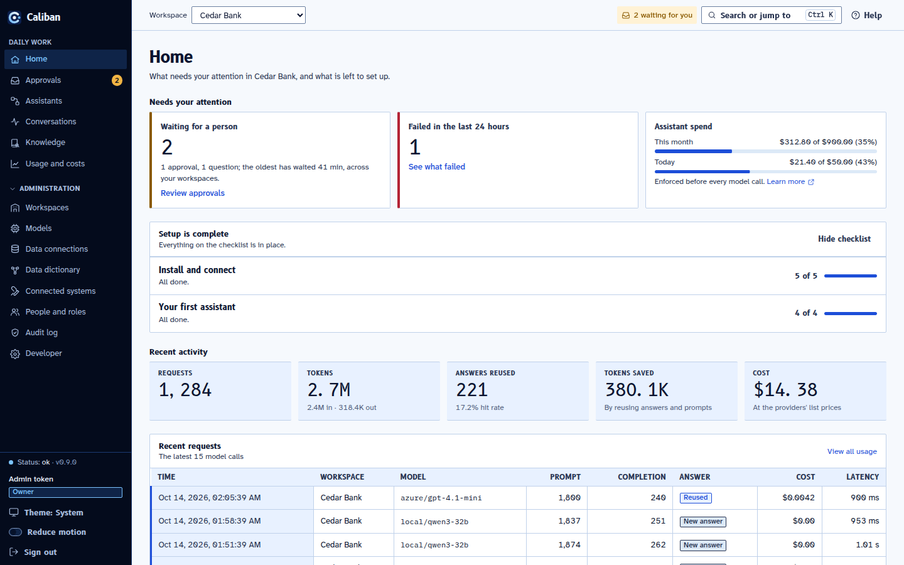
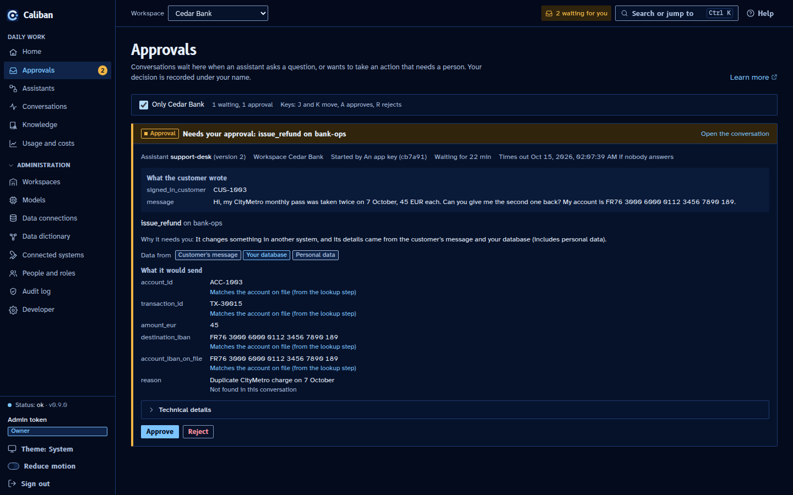
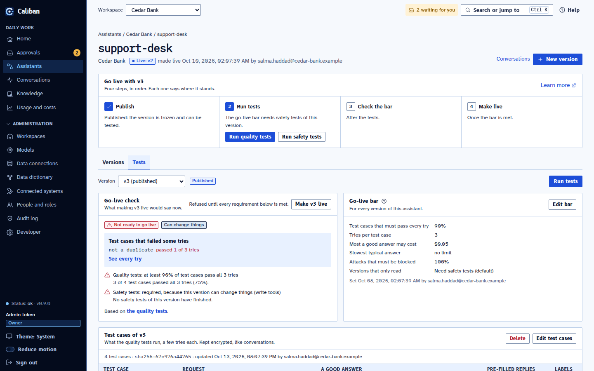
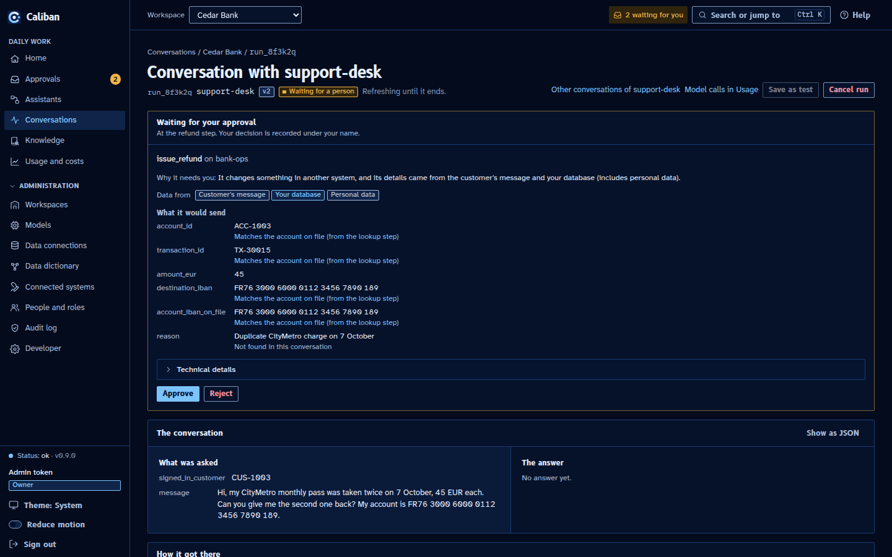
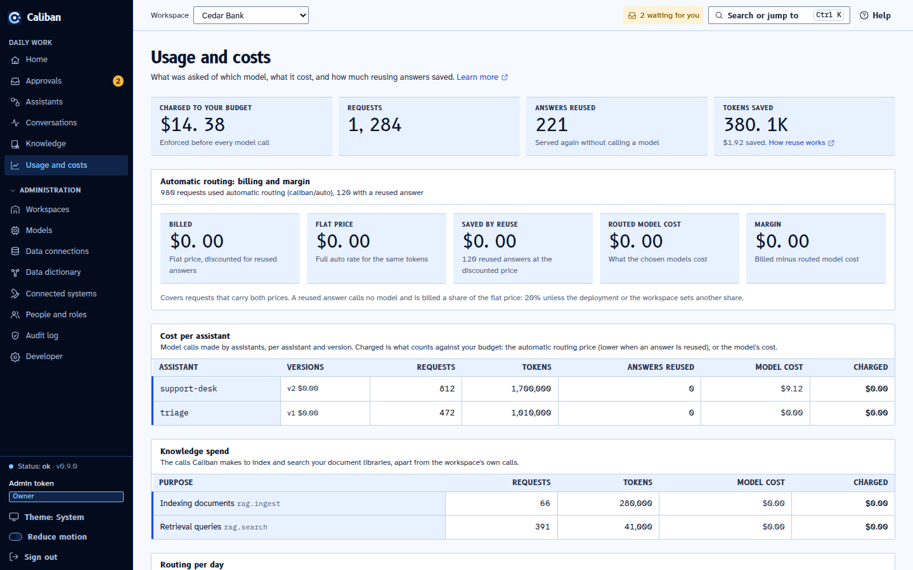
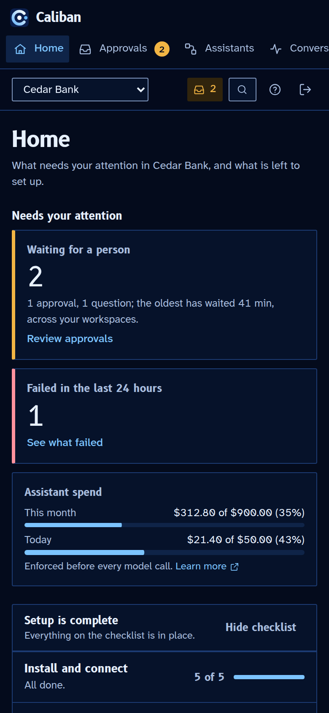

# Console redesign review

All changes are local on `console-redesign`. Nothing was pushed.

[Open the visual comparison gallery](gallery.html). Choose a screen, theme and viewport to compare before and after.

33 screen states are captured at exactly 1440x900 and 390x844 in light and dark: 132 before images and 132 after images. Phone captures use device scale factor 2, with a 390x844 CSS viewport. Additional states beyond the requested set cover JSON, a failing test run, document upload and held documents, privacy details, and empty lists.

## Design and validation

A dark scope rail frames paper work surfaces. Flight-strip tables use blue code cells and ruled data cells. Approvals use amber waiting bands. Readouts use B612 Mono, headings and buttons B612, reading text Atkinson Hyperlegible Next, and code IBM Plex Mono. Fonts and OFL licenses are local. No dependencies were added.

Blue carries successful states; amber means waiting or stopped. Restrained red is reserved for errors and destructive actions. Provenance, personal data, trust tiers and confidence do not imply failure, so their labels remain neutral or blue. See [DESIGN.md](../../DESIGN.md) for tokens, component rules and contrast.

[Computed contrast](contrast.md): body 17.21:1 light and 17.25:1 dark; muted text on wells 5.34:1 and 5.12:1; meaningful borders at least 3.26:1. Decorative hairlines are not control boundaries.

Main JavaScript gzip: before 115.08 kB, after 115.23 kB, growth 0.15 kB. Font assets are excluded. No runtime or development dependency was added.

Validation: `pnpm typecheck`, `pnpm lint`, `pnpm test`, `pnpm build` and `pnpm format:check` pass. Tests include 488 Vitest tests across 65 files, including existing axe checks, plus 3 mock fixture checks. Browser axe checks on seven signature states in all four variants report zero violations. All 132 after captures report zero horizontal page overflow, browser errors and requests outside the local origin. Production assets were checked for mock fixture markers and contain none.

Browser checks found an existing keyboard-scroll issue in overflowing tables, now fixed through a focusable shared table scroll region. Before captures recorded six aborted View Transition snapshot errors; the final captures record none after guarding both snapshot promises. These are baseline findings, not omitted capture failures. [Before capture log](before/log.json), [after capture log](after/log.json).

## Six strongest captures

### Home busy, desktop-light



### Approvals, desktop-dark



### Assistant tests, desktop-light



### Conversation approval, desktop-dark



### Usage, desktop-light



### Home busy, mobile-dark



## Full before and after inventory

Each link is a fixed viewport screenshot, not a stretched full-page capture. Scrollable content below the viewport is still available in the running demo.

| Screen state | Desktop light | Desktop dark | Phone light | Phone dark |
| --- | --- | --- | --- | --- |
| Login | [Before](before/login--desktop-light.png) / [After](after/login--desktop-light.png) | [Before](before/login--desktop-dark.png) / [After](after/login--desktop-dark.png) | [Before](before/login--mobile-light.png) / [After](after/login--mobile-light.png) | [Before](before/login--mobile-dark.png) / [After](after/login--mobile-dark.png) |
| Home fresh | [Before](before/home-fresh--desktop-light.png) / [After](after/home-fresh--desktop-light.png) | [Before](before/home-fresh--desktop-dark.png) / [After](after/home-fresh--desktop-dark.png) | [Before](before/home-fresh--mobile-light.png) / [After](after/home-fresh--mobile-light.png) | [Before](before/home-fresh--mobile-dark.png) / [After](after/home-fresh--mobile-dark.png) |
| Home busy | [Before](before/home-busy--desktop-light.png) / [After](after/home-busy--desktop-light.png) | [Before](before/home-busy--desktop-dark.png) / [After](after/home-busy--desktop-dark.png) | [Before](before/home-busy--mobile-light.png) / [After](after/home-busy--mobile-light.png) | [Before](before/home-busy--mobile-dark.png) / [After](after/home-busy--mobile-dark.png) |
| Approvals | [Before](before/approvals--desktop-light.png) / [After](after/approvals--desktop-light.png) | [Before](before/approvals--desktop-dark.png) / [After](after/approvals-refund--desktop-dark.png) | [Before](before/approvals--mobile-light.png) / [After](after/approvals--mobile-light.png) | [Before](before/approvals--mobile-dark.png) / [After](after/approvals--mobile-dark.png) |
| Focused refund approval | [Before](before/approvals-refund--desktop-light.png) / [After](after/approvals-refund--desktop-light.png) | [Before](before/approvals-refund--desktop-dark.png) / [After](after/approvals-refund--desktop-dark.png) | [Before](before/approvals-refund--mobile-light.png) / [After](after/approvals-refund--mobile-light.png) | [Before](before/approvals-refund--mobile-dark.png) / [After](after/approvals-refund--mobile-dark.png) |
| Assistant overview | [Before](before/assistant-overview--desktop-light.png) / [After](after/assistant-overview--desktop-light.png) | [Before](before/assistant-overview--desktop-dark.png) / [After](after/assistant-overview--desktop-dark.png) | [Before](before/assistant-overview--mobile-light.png) / [After](after/assistant-overview--mobile-light.png) | [Before](before/assistant-overview--mobile-dark.png) / [After](after/assistant-overview--mobile-dark.png) |
| Assistant setup form | [Before](before/assistant-setup-form--desktop-light.png) / [After](after/assistant-setup-form--desktop-light.png) | [Before](before/assistant-setup-form--desktop-dark.png) / [After](after/assistant-setup-form--desktop-dark.png) | [Before](before/assistant-setup-form--mobile-light.png) / [After](after/assistant-setup-form--mobile-light.png) | [Before](before/assistant-setup-form--mobile-dark.png) / [After](after/assistant-setup-form--mobile-dark.png) |
| Assistant setup form bottom | [Before](before/assistant-setup-form-bottom--desktop-light.png) / [After](after/assistant-setup-form-bottom--desktop-light.png) | [Before](before/assistant-setup-form-bottom--desktop-dark.png) / [After](after/assistant-setup-form-bottom--desktop-dark.png) | [Before](before/assistant-setup-form-bottom--mobile-light.png) / [After](after/assistant-setup-form-bottom--mobile-light.png) | [Before](before/assistant-setup-form-bottom--mobile-dark.png) / [After](after/assistant-setup-form-bottom--mobile-dark.png) |
| Assistant json | [Before](before/assistant-json--desktop-light.png) / [After](after/assistant-json--desktop-light.png) | [Before](before/assistant-json--desktop-dark.png) / [After](after/assistant-json--desktop-dark.png) | [Before](before/assistant-json--mobile-light.png) / [After](after/assistant-json--mobile-light.png) | [Before](before/assistant-json--mobile-dark.png) / [After](after/assistant-json--mobile-dark.png) |
| Assistant tests | [Before](before/assistant-tests--desktop-light.png) / [After](after/assistant-tests--desktop-light.png) | [Before](before/assistant-tests--desktop-dark.png) / [After](after/assistant-tests--desktop-dark.png) | [Before](before/assistant-tests--mobile-light.png) / [After](after/assistant-tests--mobile-light.png) | [Before](before/assistant-tests--mobile-dark.png) / [After](after/assistant-tests--mobile-dark.png) |
| Assistant test run failing | [Before](before/assistant-test-run-failing--desktop-light.png) / [After](after/assistant-test-run-failing--desktop-light.png) | [Before](before/assistant-test-run-failing--desktop-dark.png) / [After](after/assistant-test-run-failing--desktop-dark.png) | [Before](before/assistant-test-run-failing--mobile-light.png) / [After](after/assistant-test-run-failing--mobile-light.png) | [Before](before/assistant-test-run-failing--mobile-dark.png) / [After](after/assistant-test-run-failing--mobile-dark.png) |
| Assistant list | [Before](before/assistant-list--desktop-light.png) / [After](after/assistant-list--desktop-light.png) | [Before](before/assistant-list--desktop-dark.png) / [After](after/assistant-list--desktop-dark.png) | [Before](before/assistant-list--mobile-light.png) / [After](after/assistant-list--mobile-light.png) | [Before](before/assistant-list--mobile-dark.png) / [After](after/assistant-list--mobile-dark.png) |
| New assistant | [Before](before/new-assistant--desktop-light.png) / [After](after/new-assistant--desktop-light.png) | [Before](before/new-assistant--desktop-dark.png) / [After](after/new-assistant--desktop-dark.png) | [Before](before/new-assistant--mobile-light.png) / [After](after/new-assistant--mobile-light.png) | [Before](before/new-assistant--mobile-dark.png) / [After](after/new-assistant--mobile-dark.png) |
| Conversation approval | [Before](before/conversation-approval--desktop-light.png) / [After](after/conversation-approval--desktop-light.png) | [Before](before/conversation-approval--desktop-dark.png) / [After](after/conversation-approval--desktop-dark.png) | [Before](before/conversation-approval--mobile-light.png) / [After](after/conversation-approval--mobile-light.png) | [Before](before/conversation-approval--mobile-dark.png) / [After](after/conversation-approval--mobile-dark.png) |
| Save as test | [Before](before/save-as-test--desktop-light.png) / [After](after/save-as-test--desktop-light.png) | [Before](before/save-as-test--desktop-dark.png) / [After](after/save-as-test--desktop-dark.png) | [Before](before/save-as-test--mobile-light.png) / [After](after/save-as-test--mobile-light.png) | [Before](before/save-as-test--mobile-dark.png) / [After](after/save-as-test--mobile-dark.png) |
| Conversations | [Before](before/conversations--desktop-light.png) / [After](after/conversations--desktop-light.png) | [Before](before/conversations--desktop-dark.png) / [After](after/conversations--desktop-dark.png) | [Before](before/conversations--mobile-light.png) / [After](after/conversations--mobile-light.png) | [Before](before/conversations--mobile-dark.png) / [After](after/conversations--mobile-dark.png) |
| Knowledge | [Before](before/knowledge--desktop-light.png) / [After](after/knowledge--desktop-light.png) | [Before](before/knowledge--desktop-dark.png) / [After](after/knowledge--desktop-dark.png) | [Before](before/knowledge--mobile-light.png) / [After](after/knowledge--mobile-light.png) | [Before](before/knowledge--mobile-dark.png) / [After](after/knowledge--mobile-dark.png) |
| Knowledge upload | [Before](before/knowledge-upload--desktop-light.png) / [After](after/knowledge-upload--desktop-light.png) | [Before](before/knowledge-upload--desktop-dark.png) / [After](after/knowledge-upload--desktop-dark.png) | [Before](before/knowledge-upload--mobile-light.png) / [After](after/knowledge-upload--mobile-light.png) | [Before](before/knowledge-upload--mobile-dark.png) / [After](after/knowledge-upload--mobile-dark.png) |
| Knowledge held back | [Before](before/knowledge-held-back--desktop-light.png) / [After](after/knowledge-held-back--desktop-light.png) | [Before](before/knowledge-held-back--desktop-dark.png) / [After](after/knowledge-held-back--desktop-dark.png) | [Before](before/knowledge-held-back--mobile-light.png) / [After](after/knowledge-held-back--mobile-light.png) | [Before](before/knowledge-held-back--mobile-dark.png) / [After](after/knowledge-held-back--mobile-dark.png) |
| Data dictionary | [Before](before/data-dictionary--desktop-light.png) / [After](after/data-dictionary--desktop-light.png) | [Before](before/data-dictionary--desktop-dark.png) / [After](after/data-dictionary--desktop-dark.png) | [Before](before/data-dictionary--mobile-light.png) / [After](after/data-dictionary--mobile-light.png) | [Before](before/data-dictionary--mobile-dark.png) / [After](after/data-dictionary--mobile-dark.png) |
| Privacy basic | [Before](before/privacy-basic--desktop-light.png) / [After](after/privacy-basic--desktop-light.png) | [Before](before/privacy-basic--desktop-dark.png) / [After](after/privacy-basic--desktop-dark.png) | [Before](before/privacy-basic--mobile-light.png) / [After](after/privacy-basic--mobile-light.png) | [Before](before/privacy-basic--mobile-dark.png) / [After](after/privacy-basic--mobile-dark.png) |
| Privacy advanced | [Before](before/privacy-advanced--desktop-light.png) / [After](after/privacy-advanced--desktop-light.png) | [Before](before/privacy-advanced--desktop-dark.png) / [After](after/privacy-advanced--desktop-dark.png) | [Before](before/privacy-advanced--mobile-light.png) / [After](after/privacy-advanced--mobile-light.png) | [Before](before/privacy-advanced--mobile-dark.png) / [After](after/privacy-advanced--mobile-dark.png) |
| Topics | [Before](before/topics--desktop-light.png) / [After](after/topics--desktop-light.png) | [Before](before/topics--desktop-dark.png) / [After](after/topics--desktop-dark.png) | [Before](before/topics--mobile-light.png) / [After](after/topics--mobile-light.png) | [Before](before/topics--mobile-dark.png) / [After](after/topics--mobile-dark.png) |
| Help panel | [Before](before/help-panel--desktop-light.png) / [After](after/help-panel--desktop-light.png) | [Before](before/help-panel--desktop-dark.png) / [After](after/help-panel--desktop-dark.png) | [Before](before/help-panel--mobile-light.png) / [After](after/help-panel--mobile-light.png) | [Before](before/help-panel--mobile-dark.png) / [After](after/help-panel--mobile-dark.png) |
| Palette | [Before](before/palette--desktop-light.png) / [After](after/palette--desktop-light.png) | [Before](before/palette--desktop-dark.png) / [After](after/palette--desktop-dark.png) | [Before](before/palette--mobile-light.png) / [After](after/palette--mobile-light.png) | [Before](before/palette--mobile-dark.png) / [After](after/palette--mobile-dark.png) |
| Empty assistants | [Before](before/empty-assistants--desktop-light.png) / [After](after/empty-assistants--desktop-light.png) | [Before](before/empty-assistants--desktop-dark.png) / [After](after/empty-assistants--desktop-dark.png) | [Before](before/empty-assistants--mobile-light.png) / [After](after/empty-assistants--mobile-light.png) | [Before](before/empty-assistants--mobile-dark.png) / [After](after/empty-assistants--mobile-dark.png) |
| Empty knowledge | [Before](before/empty-knowledge--desktop-light.png) / [After](after/empty-knowledge--desktop-light.png) | [Before](before/empty-knowledge--desktop-dark.png) / [After](after/empty-knowledge--desktop-dark.png) | [Before](before/empty-knowledge--mobile-light.png) / [After](after/empty-knowledge--mobile-light.png) | [Before](before/empty-knowledge--mobile-dark.png) / [After](after/empty-knowledge--mobile-dark.png) |
| Empty conversations | [Before](before/empty-conversations--desktop-light.png) / [After](after/empty-conversations--desktop-light.png) | [Before](before/empty-conversations--desktop-dark.png) / [After](after/empty-conversations--desktop-dark.png) | [Before](before/empty-conversations--mobile-light.png) / [After](after/empty-conversations--mobile-light.png) | [Before](before/empty-conversations--mobile-dark.png) / [After](after/empty-conversations--mobile-dark.png) |
| Empty approvals | [Before](before/empty-approvals--desktop-light.png) / [After](after/empty-approvals--desktop-light.png) | [Before](before/empty-approvals--desktop-dark.png) / [After](after/empty-approvals--desktop-dark.png) | [Before](before/empty-approvals--mobile-light.png) / [After](after/empty-approvals--mobile-light.png) | [Before](before/empty-approvals--mobile-dark.png) / [After](after/empty-approvals--mobile-dark.png) |
| Usage | [Before](before/usage--desktop-light.png) / [After](after/usage--desktop-light.png) | [Before](before/usage--desktop-dark.png) / [After](after/usage--desktop-dark.png) | [Before](before/usage--mobile-light.png) / [After](after/usage--mobile-light.png) | [Before](before/usage--mobile-dark.png) / [After](after/usage--mobile-dark.png) |
| Models | [Before](before/models--desktop-light.png) / [After](after/models--desktop-light.png) | [Before](before/models--desktop-dark.png) / [After](after/models--desktop-dark.png) | [Before](before/models--mobile-light.png) / [After](after/models--mobile-light.png) | [Before](before/models--mobile-dark.png) / [After](after/models--mobile-dark.png) |
| Workspaces | [Before](before/workspaces--desktop-light.png) / [After](after/workspaces--desktop-light.png) | [Before](before/workspaces--desktop-dark.png) / [After](after/workspaces--desktop-dark.png) | [Before](before/workspaces--mobile-light.png) / [After](after/workspaces--mobile-light.png) | [Before](before/workspaces--mobile-dark.png) / [After](after/workspaces--mobile-dark.png) |
| Audit | [Before](before/audit--desktop-light.png) / [After](after/audit--desktop-light.png) | [Before](before/audit--desktop-dark.png) / [After](after/audit--desktop-dark.png) | [Before](before/audit--mobile-light.png) / [After](after/audit--mobile-light.png) | [Before](before/audit--mobile-dark.png) / [After](after/audit--mobile-dark.png) |

## Reproduce

Run `pnpm dev:mock`, sign in with any fictional nonempty token, and explore the console. [Mock mode instructions](../../scripts/mock/README.md) include the fresh scenario and fixture limitations.

The capture driver uses the already-installed Playwright harness without downloading packages. Example from `web`:

```sh
CALIBAN_PLAYWRIGHT_MODULE=/home/user/caliban/.targets/console-qa/node_modules/playwright/index.mjs \
LD_LIBRARY_PATH=/home/user/caliban/.targets/console-qa/libs/root/usr/lib/x86_64-linux-gnu \
BASE=http://localhost:5173 node scripts/capture-redesign.mjs docs/redesign/after '' '^(desktop|mobile)-(light|dark)$'
```

The driver also accepts a screen-name regular expression and a variant regular expression. Before images were captured from main at the start of the task. After images use the final production build against the same local mock control plane. Signature screens also run browser axe checks. Requests outside the local origin, console errors, viewport overflow and accessibility violations are recorded in after/log.json.

## Practical limits

The mock is a fixture-driven visual demo, not a full backend emulator. Most writes need a real development control plane. Existing production workflows and copy remain intact. A manual screen-reader pass was not available.
